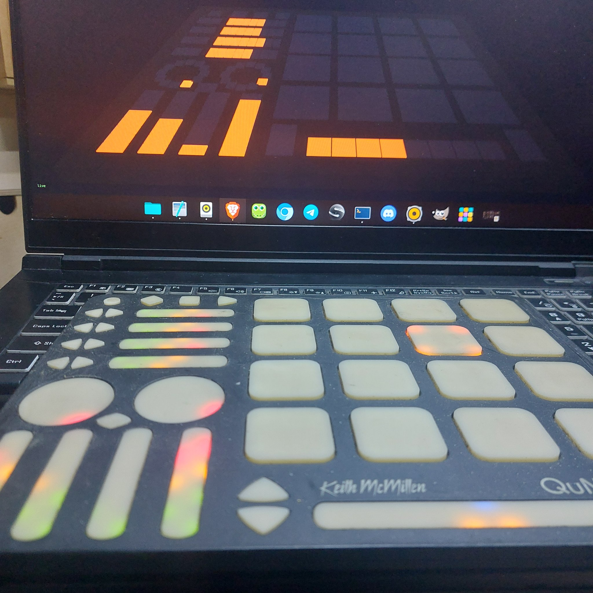

# super-quneo-collider

QuNeo vertical-slider MIDI CC to a live SuperCollider synth parameter, exposed
over HTTP at `/api/collider`. A three.js model of the board mirrors the physical
QuNeo's lit/unlit state across the full control surface, and a `<select>`
switches which example SynthDef the sliders drive.



## Install

```bash
./install.sh   # idempotent: supercollider + .venv + editable install
```

## Run

```bash
.venv/bin/python -m super_quneo_collider.server
```

Then open `http://127.0.0.1:8686` for the board, and hit
`http://127.0.0.1:8686/api/collider` for
`{"present": bool, "examples": [...], "activeExample": str, "fadeEnabled": bool, "voices": [...], "sliders": {...}, "cc": {...}, "note": {...}}`.

The bridge boots scsynth, loads every example SynthDef, links scsynth's pipewire
output (the "SuperCollider" client) to the default audio sink with `pw-link`
(best effort), and then waits. Nothing is audible until you touch the QuNeo.
QuNeo activity (a vSlider CC on channel 15) spawns one voice for the active
example; further activity retunes that same node instead of stacking new ones.

## Voices: how a sound ends

Every SynthDef carries the same wrapper, so no example can run away:

- The bridge picks the node id and tracks it, so it can always stop what it
  started. Selecting a different example, or releasing, sends `gate=0`, which
  runs a 3 s fade-out rather than cutting the sound.
- A gate-independent 12 s ceiling fades out anything still running, whatever the
  def does on its own. `fade=0` replaces that ceiling with a constant, so a voice
  rings until something stops it.
- The checkbox beside the example select toggles the ceiling. Its state lives in
  the bridge (`fadeEnabled`, `POST /api/collider/fade`), and the page re-renders
  the box from each poll.

## Board mirror

The three.js board reflects the real QuNeo, not just the three bound sliders:

- vSliders fill toward the top, and horizontal/long sliders toward the right,
  pads light a four-corner brightness field from finger pressure and position
  and latch their last-lit corners after release (dark only before the first
  press), buttons latch, and the two rotaries show a single red position
  indicator on a ring.
- LED colour is per-position, not a value ramp: each slider is a fixed
  green/yellow/red ladder the value fills (never recolours), the long slider is
  a 17-light crossfader swept by a 3-light window with a blue centre, and the
  rotaries are red only — matching the physical board.
- Raw CC and note state is tracked per MIDI channel (channel 15 controls plus
  the two channel-14 rotaries), so every control lights in step with the board.
- Last-known state persists to `$XDG_STATE_HOME/super-quneo-collider/state.json`
  and reloads on boot, so a bridge restart does not blank the board.

## Audio

The bridge keeps scsynth's output wired to whichever pipewire sink is currently
default, re-discovering it every few seconds. Spot a new output device and
activate it (e.g. pair a Bluetooth speaker and set it as the default sink) and
the audio follows without a restart. No manual `pw-link` is needed.

Requires a pipewire/pulse system with `pw-link` and `pactl` on `PATH`.

## Test

```bash
.venv/bin/pytest
```

Backend tests run with no hardware. Frontend tests are browser-harness based
(open `client/tests/index.html`); tests marked `scsynth_ok` exercise a real
scsynth boot and skip when scsynth is not installed.
